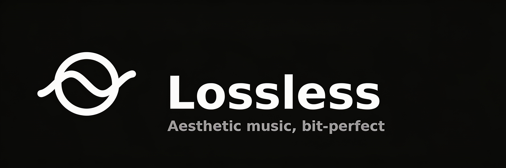

<div align="center">

<br/>



# Lossless

### An aesthetic YouTube Music client, with LastWave addons for real lossless audio

<br/>

[](https://github.com/daddyyour0786-dev/Lossless/releases)
[](https://github.com/daddyyour0786-dev/Lossless/blob/main/LICENSE)
[](https://github.com/daddyyour0786-dev/Lossless/releases)

<br/>

[**Download**](#download) · [**Addons**](#addons) · [**Features**](#features) · [**Building**](#building) · [**Credits**](#credits)

</div>

> [!IMPORTANT]
> Lossless is not affiliated with, endorsed by, or connected to YouTube, Google, or
> LastWave in any way. It ships no catalogue of its own: everything you play comes
> from a source you configure, and you are responsible for how you use it.

---

## Download

Grab the newest APK from [**Releases**](https://github.com/daddyyour0786-dev/Lossless/releases/latest)
and install it. `Lossless-<version>.apk` works on any phone; the `_<abi>` files are
smaller builds for one processor each.

Once installed you never have to come back here: every running copy checks this
repository's newest release on launch and offers the update inside the app, with a
"what's new" list and an in-app download. Updates install over the old build, so
your library, downloads and sign-ins are kept.

Requires Android 8.0 (API 26) or newer.

---

## Addons

Lossless plays lossless audio through **addons** — small HTTP servers that answer
three questions (`/manifest.json`, `/search`, `/stream/{id}`) and hand back FLAC,
ALAC or hi-res files. Nothing is downloaded and executed to make one work; Lossless
asks it for tracks and plays what comes back.

The addon network this app is built around is
[**LastWave addons**](https://lastwaveaddons.clashprojects.qd.je):

1. **Create an account** at [lastwaveaddons.clashprojects.qd.je](https://lastwaveaddons.clashprojects.qd.je)
   and verify through Telegram or Discord.
2. You get a **personal endpoint** that looks like
   `https://lastwaveaddons.clashprojects.qd.je/a/your-token`.
3. In Lossless: **Settings → Sources → Add an addon**, paste it, tap **Test**, then
   **Save**.

Lossless signs every request to a token-bearing addon the way that network expects
(HMAC-SHA256 over the timestamp, method, path and token — see
[`AddonSigning.kt`](app/src/main/java/com/lossless/app/data/sources/addon/AddonSigning.kt)).
That is the whole reason those addons work here rather than failing with a refusal:
an addon endpoint is not a public URL, it is a signed conversation.

Any number of addons can be added and **dragged into the order you want them
tried**. Sources you add are asked before anything the app falls back to, and
YouTube Music stays at the end so playback always has somewhere to land. Addons you
host yourself work too, if they speak the same protocol.

---

## Features

#### Playback
- **Search, browse and play** anything on YouTube Music.
- **Lossless audio** from your addons, with YouTube Music as the fallback.
- **Gapless playback with real crossfade**, 0–12 s.
- **Automix** — DJ-style transitions with beat-matching and tempo-stretching.
- **Offline downloads** with embedded metadata.
- **Local files** and your own library.
- **Background playback** through a proper foreground media session.
- **Bit-perfect USB DAC output**, with the device's own hardware volume.
- **Apple-style lyrics animation** — credit to [binimum](https://github.com/binimum/am-lyrics).

#### Listen Together
- Everyone in the party hears the same track at the same second, on their own
  device, with their own volume and their own audio output.
- Sharing sends a link that opens Lossless directly — and, for somebody who does
  not have it yet, tells them where to get it.

#### Connectivity
- **Sign in with Google** for your own library and recommendations.
- **Spotify** playlists and Liked Songs.
- **Discord Rich Presence.**
- **Scrobbling** to Last.fm and ListenBrainz.
- **WebDAV and SMB** libraries.

#### Look
- **Material 3 Expressive** with album-art colour extraction.
- **One icon, two themes**: the Struck Circle is black on a near-white tile in
  light mode and white on black in dark mode, switching with the system. A themed
  (monochrome) variant is in Settings for launchers that tint icons.
- Everything above is drawn from one file —
  [`tools/lossless_mark.py`](tools/lossless_mark.py) — so the launcher icon, the
  notification glyph and the logo cannot drift apart.

---

## Building

You need **JDK 17** and the **Android SDK** (compileSdk 37, plus CMake and the NDK
for the native audio and QuickTime-era decoder shims). Android Studio will set all
of that up; from a terminal:

```bash
git clone https://github.com/daddyyour0786-dev/Lossless.git
cd Lossless
echo "sdk.dir=/path/to/Android/Sdk" > local.properties
./gradlew assembleProdDebug          # app/build/outputs/apk/prod/debug/
```

Optional credentials, each of which the build runs fine without, go in
`local.properties`:

```properties
LASTFM_API_KEY=…
LASTFM_SECRET=…
LISTEN_TOGETHER_SERVER=https://your-party-server.example.com
ADDON_SIGNING_SECRET=…            # only if your addon server uses its own key
```

Releasing — version bumps, tags, signing secrets and the CI build — is documented
in [**RELEASING.md**](RELEASING.md).

---

## Project layout

```
app/       The Android app: UI, playback, sources, addons
shared/    Platform-free models and repositories, shared with the desktop target
sharedUi/  Compose UI shared between Android and desktop
backend/   The Listen Together party server (Go) — self-hosted, see backend/README.md
native/    C/C++: the FFmpeg audio decoder and the bit-perfect USB path
tools/     The mark, the icon generator, the version bump script
```

There is no TV app, no Wear OS app and no web client: those targets were removed in
0.1.0 so that the phone app is the whole of what has to work.

---

## Credits

Lossless is a fork of [**BitChord**](https://github.com/kushagrasinghx/BitChord) by
[Kushagra Singh](https://github.com/kushagrasinghx), and most of what is good about
it is his work. It is GPL-3.0, as BitChord is, and this repository is the source
for the binaries published here.

It stands on other people's work too:

| Project | What it does here |
|:--|:--|
| [BitChord](https://github.com/kushagrasinghx/BitChord) | The app Lossless is forked from |
| [LastWave](https://github.com/Clash-Projects/LastWave-Native) | The addon protocol Lossless speaks |
| [NewPipe Extractor](https://github.com/TeamNewPipe/NewPipeExtractor) | YouTube stream resolution |
| [InnerTubeX](https://github.com/MetrolistGroup/innertubex) | The InnerTube client catalog |
| [am-lyrics](https://github.com/binimum/am-lyrics) | The lyrics animation |
| [Beat This!](https://github.com/mir-aidj/all-in-one) | On-device beat tracking for Automix |
| [Jetpack Compose](https://developer.android.com/jetpack) & [Media3](https://developer.android.com/media/media3) | UI toolkit and audio engine |
| [LRCLIB](https://lrclib.net) | Synchronised lyrics |

The same list is in the app, at the bottom of **Settings**.

---

## Licence

GPL-3.0. See [LICENSE](LICENSE). Because it is a fork, the licence and the
attribution to BitChord stay — that is a condition of the licence, not a courtesy.
